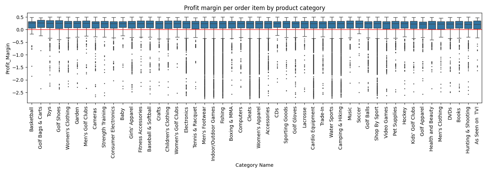
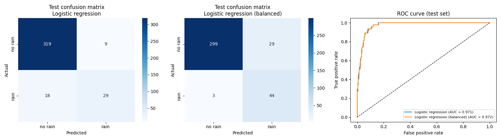
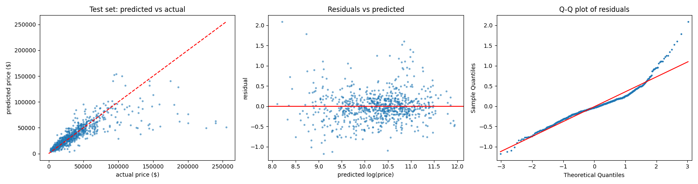

# Data Science Projects

Three data analysis and modelling projects: exploratory analysis of a supply chain, rain prediction with logistic regression, and used-car price prediction with multiple linear regression.

## Coursework

Work done for the **Data Science** course, Semester 3, Plaksha University.

| Folder | Project | Course work |
|---|---|---|
| `dataco-supply-chain/` | DataCo supply chain analysis | Assignment 1 |
| `rain-prediction/` | Rain prediction with logistic regression | Assignment 3A |
| `used-car-prices/` | Used car price regression | Linear regression lab |

## 1. DataCo supply chain analysis

Exploratory analysis of 180,519 orders (53 columns). It covers data quality, sales and profit by customer segment, region and product category, customer lifetime value and profit margins, and ends with a written business report.

Key findings:
- The Consumer segment brings in about half of all sales and profit. All segments have nearly the same margin (10.6-10.9%).
- Western Europe and Central America are the largest regions. Canada, Central Asia and Southern Africa are the smallest but have the highest margins (12-13.5%).
- Fishing earns the most revenue even though other categories have more orders.
- Customer lifetime value is almost identical across segments (about 5,260-5,370 over 3 years).
- About 19% of order items are sold at a loss.



**Data:** the dataset (57 MB) is not included. Download "DataCo Smart Supply Chain for Big Data Analysis" from Kaggle and save it as `dataco-supply-chain/data/DataCoSupplyChainDataset.xlsx`.

## 2. Rain prediction

Logistic regression on 2,500 days of weather data (temperature, humidity, wind speed, cloud cover, pressure), where only 12.6% of days are rainy.

| Model (test set) | Accuracy | Precision | Recall | F1 | AUC-ROC |
|---|---|---|---|---|---|
| Logistic regression | 0.928 | 0.763 | 0.617 | 0.682 | 0.971 |
| Logistic regression, class-balanced | 0.915 | 0.603 | 0.936 | 0.733 | 0.972 |

Humidity and cloud cover are the strongest predictors, and higher temperature makes rain less likely. Class balancing catches 94% of rainy days instead of 62%, at the cost of more false alarms.



## 3. Used car price regression

Part 1 computes simple linear regression by hand (slope, intercept, RSS, TSS and R^2). Part 2 predicts the prices of 4,009 used cars with multiple linear regression. Features are extracted from text columns: age, mileage, horsepower and litres parsed from the engine description, transmission, accident history, fuel type and brand. The model predicts log(price).

| | R^2 | Adjusted R^2 |
|---|---|---|
| Training set | 0.791 | 0.789 |
| Test set (unseen cars) | 0.792 | 0.784 |

Mean absolute error on test cars is about $10,300. Each year of age lowers the price by about 4.7%, each 10,000 miles by about 5.8%, and a reported accident by about 8.4%. Durbin-Watson = 1.96.



## How to run

```
pip install -r requirements.txt
jupyter notebook
```

Each notebook is run from its own folder and is saved with all outputs.

## Notes on the cleanup

- **DataCo:** the "profit by region" chart in the original actually plotted sales. It now shows orders, sales and profit side by side. All insights were rechecked against the computed numbers.
- **Rain prediction:** the data was scaled before splitting, so information leaked from the test set into training. The split now happens first. A class-balanced model was added because the classes are imbalanced.
- **Used cars:** the original one-hot encoded every car model and engine string (thousands of columns for 4,009 cars). It reported an adjusted R^2 of 0.94 on the training data, but scored 0.07 on the test set. The model was rebuilt with engineered features and evaluated on held-out data.
